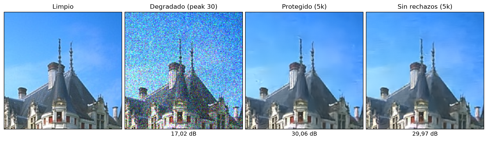
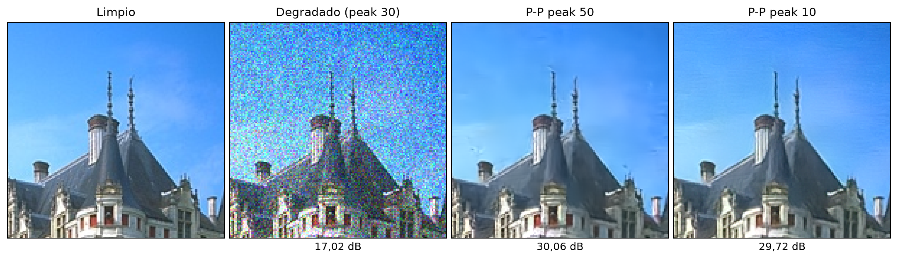
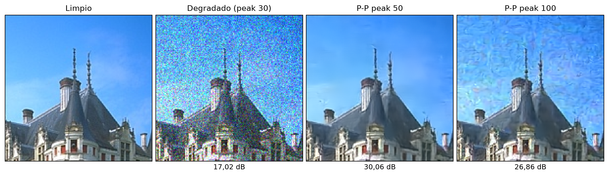
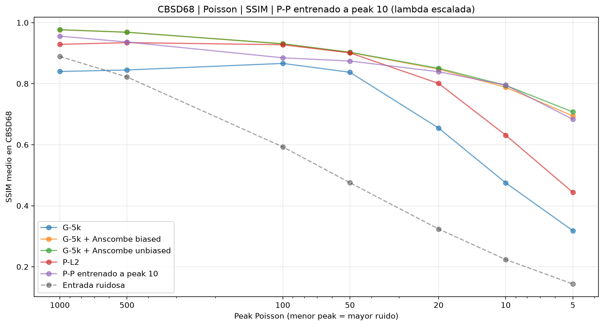
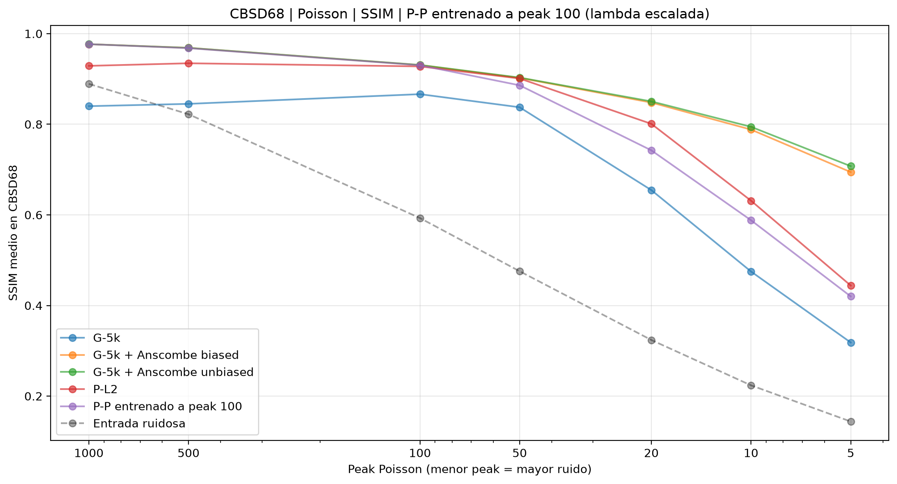
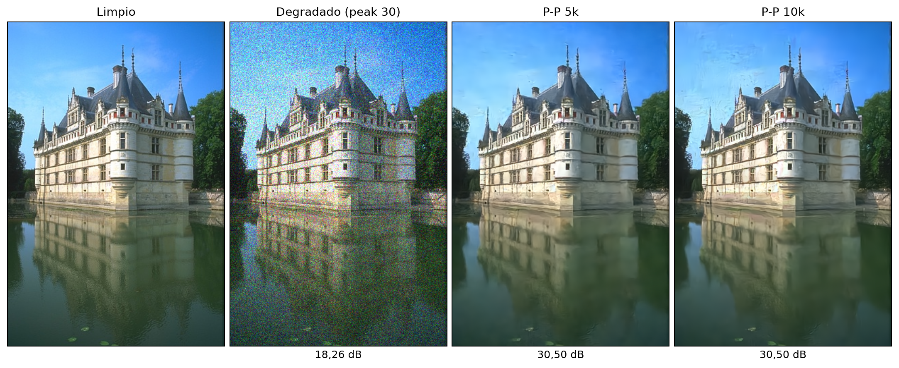
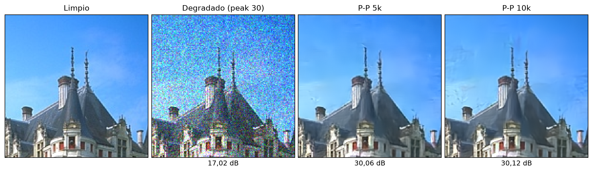
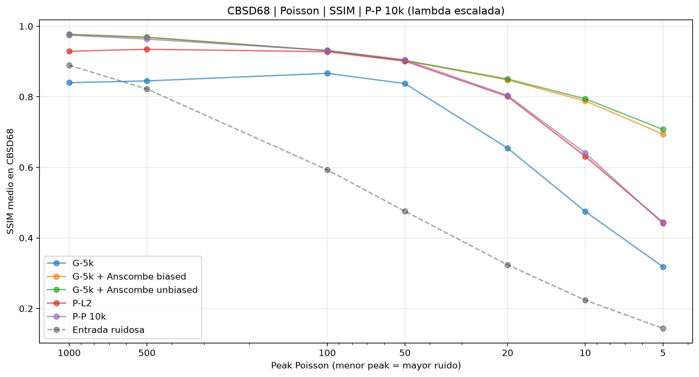
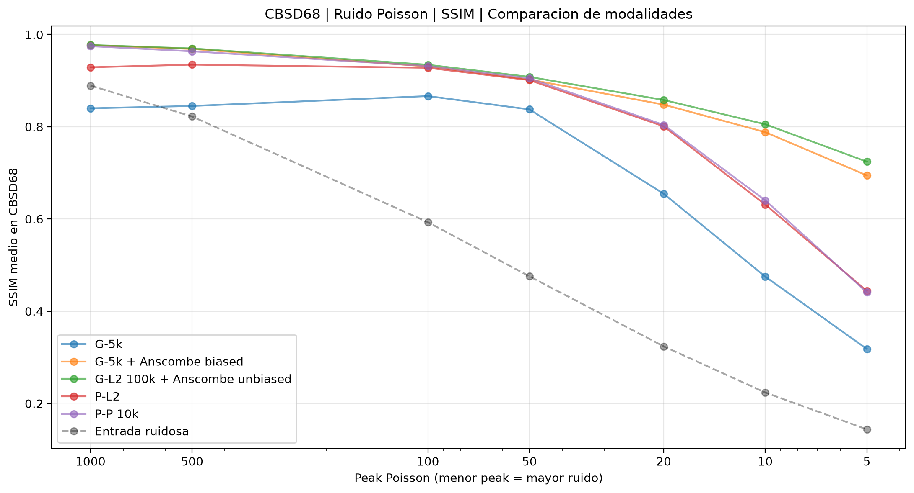

# TDV y ruido Poisson

## 1. Motivación y preguntas

Se plantearon dos preguntas que guiaron el diagnóstico y posteriores experimentos:

- **Problema 1: Inestabilidad del entrenamiento, rechazos, rebobinados**: ¿qué relación tienen los picos del gradiente durante el entrenamiento con los artefactos de la reconstrucción?

- **Problema 2: Rendimiento de modelos entrenados con Poisson a bajos peaks**: ¿Cuánto de la caída a pocos conteos se explica por entrenar y evaluar a distintos peaks (y con la inestabilidad-)?

   
  <em>SSIM frente al peak de evaluación. P-P conserva el λ aprendido.</em>

   
  <em>SSIM frente al peak de evaluación. P-P ajusta λ en proporción al peak de prueba.</em>

## 2. Inestabilidad del entrenamiento

| Registro a peak 50 | P-L2 (fidelidad cuadrática) | P-P (fidelidad Poisson) |
|---|---:|---:|
| Iteraciones completadas | 5.000 | 5.000 |
| Lotes rechazados | 140 (2,80 %) | 144 (2,88 %) |
| Máximo de rechazos consecutivos | 25 | 25 |
| Rebobinados | 4 | 4 |
| PSNR final en CBSD68 | 31,64 dB | 31,66 dB |

- Se tienen dos entrenamientos que llegaron a un PSNR parecido y necesitaron el mismo número de rebobinados.

- Ruido poisson posible responsable.

## 3. Diagnósticos

**Localización del rechazo** 

- Se emplearon checkpoints de 1.000 iteraciones de P-L2 y P-P a peak 50. En este punto ya se presentaron rechazos.

- Se registraron las entradas, la pérdida y el gradiente a ambos lados de cada operación (etapas).

| Diagnóstico a peak 50, S=10 | P-L2 (fidelidad cuadrática)| P-P (fidelidad Poisson) |
|---|---:|---:|
| Iteraciones completadas | 1.000 | 1.000 |
| Lotes rechazados | 51 (5,10 %) | 85 (8,50 %) |
| Máximo de rechazos consecutivos | 25 | 25 |
| Rebobinados | 1 | 2 |
| PSNR final en CBSD68 | 30,79 dB | 30,86 dB |

- La reconstrucción comienza con $x_0=z$ y recorre $S$ etapas. 
- En la etapa $k$: $h=T/S$ para el regularizador aprendido $R_\theta$ y $\eta=\lambda/S$ para la fidelidad $D$.

1. **Paso explícito del regularizador.** 

$$
v_k=x_{k-1}-h\,\nabla R_\theta(x_{k-1}).
$$

2. **Paso implícito de fidelidad.** 
$$
x_k=\operatorname{prox}_{\eta D(\cdot,z)}(v_k)
=\underset{u}{\arg\min}\left\{\tfrac12\lVert u-v_k\rVert_2^2+\eta D(u,z)\right\}.
$$

$$
\text{P-L2:}\quad \frac{v+\eta z}{1+\eta},
\qquad
\text{P-P:}\quad \frac{v-\eta+\sqrt{(v-\eta)^2+4\eta z}}{2}.
$$

Luego, los diagnósticos analizan lo sucedido en los gradientes del backward:

- Se pasa de $x_k$ a $v_k$ (regularizador), luego a (fidelidad) $x_{k-1}$ en un flujo típico.
- El efecto del paso en una determinada etapa determina donde creció.
- Proximal: $\|\partial L/\partial x_k\|$ con $\|\partial L/\partial v_k\|$. Si la segunda es mayor, el proximal amplificó el gradiente recibido. 
- Regularizador: $\|\partial L/\partial v_k\|$ con $\|\partial L/\partial x_{k-1}\|$. Si la segunda es mayor, el paso del regularizador lo amplificó.

**P-P: iteración 489, microlote 1.** 

| Etapa $k$ | Norma en $x_k$ | Norma en $v_k$ | Norma en $x_{k-1}$ | Factor proximal | Factor regularizador |
|---|---:|---:|---:|---:|---:|
| 10 | 2,27 | 2,20 | 3,95 | 0,97× | 1,79× |
| 9 | 3,95 | 3,83 | 9,74 | 0,97× | 2,55× |
| 8 | 9,74 | 9,40 | 29,68 | 0,96× | 3,16× |
| 7 | 29,68 | 28,69 | 100,82 | 0,97× | 3,51× |
| 6 | 100,82 | 97,24 | 376,77 | 0,96× | 3,87× |
| 5 | 376,77 | 367,83 | 1.587,50 | 0,98× | 4,32× |
| 4 | 1.587,50 | 1.534,92 | 9.189,27 | 0,97× | 5,99× |
| 3 | 9.189,27 | 8.990,89 | 13.010,96 | 0,98× | 1,45× |
| 2 | 13.010,96 | 12.219,93 | 18.952,47 | 0,94× | 1,55× |
| 1 | 18.952,47 | 17.836,31 | No registrado | 0,94× | — |

[Registro P-P](diagnostico/diag_pp_peak50_s0_1k/diagnostico.jsonl). Entre $x_{10}$ y $x_1$, la norma aumenta 8.336,20 veces.

**P-L2: iteración 859, microlote 2.**

| Etapa $k$ | Norma en $x_k$ | Norma en $v_k$ | Norma en $x_{k-1}$ | Factor proximal | Factor regularizador |
|---|---:|---:|---:|---:|---:|
| 10 | 1,85 | 1,84 | 1,80 | 0,99× | 0,97× |
| 9 | 1,80 | 1,78 | 1,84 | 0,99× | 1,03× |
| 8 | 1,84 | 1,83 | 2,08 | 0,99× | 1,14× |
| 7 | 2,08 | 2,07 | 3,99 | 0,99× | 1,92× |
| 6 | 3,99 | 3,96 | 10,42 | 0,99× | 2,63× |
| 5 | 10,42 | 10,35 | 28,36 | 0,99× | 2,74× |
| 4 | 28,36 | 28,19 | 69,74 | 0,99× | 2,47× |
| 3 | 69,74 | 69,30 | 345,71 | 0,99× | 4,99× |
| 2 | 345,71 | 343,53 | 311,38 | 0,99× | 0,91× |
| 1 | 311,38 | 309,41 | No registrado | 0,99× | — |

[Registro P-L2](diagnostico/diag_pl2_peak50_s0_1k/diagnostico.jsonl). Entre $x_{10}$ y $x_1$, la norma aumenta 168,00 veces.

## 4. Remedios

Producto de los anteriores resultados, se plantearon los siguientes experimentos:

- **Tamaño del paso y S=20.**: Investigar reducción de gradiente mediante un $S$ mayor ($\tau$ decrece). El regularizador hace que se rechaze finalmente una actualización (inferencia y entrenamiento).

- **Entrenamiento sin rechazos de gradientes finitos.** Dejar que el optimizador (Adam) no sea bloqueado y actualize pesos sin límite de tamaño al gradiente (no inf). Se pretende observar si el aprendizaje resulta mejor sin límites.

- **Más iteraciones y especialización por peak.** Entrenar a $peak = 10$ y $peak = 100$ y observar como cambia la inestabilidad (rechazos). Probar más iteraciones (10k), ya que se observó que los rechazos se concentran en bajas iteraciones. Comparación con Anscombe 100k, probar si la especialización de 10k de P-P es suficiente, costo por aprendizje, etc.

## 5. Resultados

### 5.1 (S = 20)

**Inferencia: Comparación S= 20 v/s S= 10, mismo checkpoint**

*Comparación en inferencia con pesos congelados.*

- Reducir el tamaño de los pasos aumentando S no mejoró la reconstrucción en este ejemplo con pesos congelados.

**Evaluación en CBSD68 a peak 50 (mismo checkpoint de 1k).**

| S del entrenamiento | S en inferencia | PSNR medio (dB) | SSIM medio |
|---|---:|---:|---: |
| 10 | 10 | 30,86 | — |
| 10 | 20 | 30,22 | 0,8653 |

**Entrenamiento: Comparación S=20 v/s S=10, checkpoints a 1k**

*Comparación de modelos entrenados con distinto S.* 

- Entrenar con veinte etapas tampoco mejoró el PSNR de este ejemplo, aunque la caída fue menor que al cambiar únicamente S en inferencia. 

**Evaluación en CBSD68 a peak 50 (checkpoints finales a 1k).**

| S del entrenamiento | S en inferencia | PSNR medio (dB) | SSIM medio |
|---|---:|---:|---: |
| 10 | 10 | 30,86 | — |
| 20 | 20 | 30,73 | 0,8806 |

La evaluación del checkpoint entrenado con S=20 alcanzó **30,73 dB** 

### 5.2 (No rechazos)

**Entrenamiento sin rechazos de gradientes finitos: comparación a 5k**

*Comparación con y sin protección.* Se usan los checkpoints finales de 5.000 iteraciones, entrenados a peak 50 con S=10. 

**Evaluación en CBSD68 a peak 30, ambos modelos con λ escalada.**

| Modelo a 5k | PSNR medio (dB) | SSIM medio |
|---|---:|---:|
| Observación degradada | 18,69 | 0,3892 |
| P-P protegido | 30,22 | 0,8696 |
| P-P sin rechazos de gradientes finitos | 30,21 | 0,8662 |

- Durante el entrenamiento, el protegido registró **144 rechazos y 4 rebobinados**, frente a **0 y 0** sin protección. 
#### 5.3 (Diferente peak de entrenamiento)

**Entrenamiento a peak 10 y peak 100: estabilidad y generalización a 5k**

- Se compararon modelos P-P entrenados desde cero a peaks 10, 50 y 100, con S=10, semilla 0 y 5.000 iteraciones.

| Peak de entrenamiento | Rechazos | Rebobinados | Peak de evaluación | PSNR en CBSD68 (dB) |
|---|---:|---:|---:|---:|
| 10 | 455 | 9 | 10 | 27,67 |
| 50 | 144 | 4 | 50 | 31,66 |
| 100 | 162 | 5 | 100 | 33,47 |

- El entrenamiento a peak 10 acumuló más rechazos y rebobinados que los otros dos. 

**Comparación del castillo a peak 30, con todos los modelos escalados.**

**Evaluación en CBSD68 a peak 30, con λ escalada en cada modelo.**

| Modelo a 5k | PSNR medio (dB) | SSIM medio |
|---|---:|---:|
| Observación degradada | 18,69 | 0,3892 |
| P-P entrenado a peak 10 | 29,80 | 0,8586 |
| P-P entrenado a peak 50 | 30,22 | 0,8696 |
| P-P entrenado a peak 100 | 28,90 | 0,8172 |

**Curvas de validación frente al peak.** 

- En cada figura se reemplaza únicamente la curva P-P por el especialista indicado; G-L2, Anscombe y P-L2 conservan sus resultados del barrido original.

- La especialización recupera una brecha grande a pocos conteos, pero no ofrece una mejora uniforme entre peaks. 

- La cantidad de rechazos sola no explica el rendimiento.

- El especialista de peak 10 mejora en sus peaks cercanos a pesar de presentar mayor rechazos.

#### 5.4 Más iteraciones: P-P estándar a 5k y 10k

**Validación registrada en CBSD68 a peak 50.**

| Modelo | Iteraciones | PSNR medio (dB) | Rechazos acumulados | Rebobinados |
|---|---:|---:|---:|---:|
| P-P estándar | 5.000 | 31,661 | 144 | 4 |
| P-P estándar | 10.000 | 31,827 | 150 | 3 |

- El modelo de 10k mejora el PSNR de validación en **0,167 dB** respecto al de 5k

- El historial de 10k registra 31,7278, 31,7748 y 31,8271 dB a 6k, 8k y 10k, respectivamente.

- Rechazos no crecen linealmente.

**Evaluación en CBSD68 a peak 30, con λ escalada por 0,6.**

| Modelo | PSNR medio (dB) | SSIM medio |
|---|---:|---:|
| Observación degradada | 18,69 | 0,3892 |
| P-P estándar 5k | 30,22 | 0,8696 |
| P-P estándar 10k | 30,21 | 0,8651 |

- No hay mejora evidente a en el peak = 30 (artefactos)

**Castillo completo y recorte a peak 30, ambos modelos escalados.**

- Persisten irregularidades visibles en el cielo, más marcadas en algunas zonas con 10k.

- Ganancias en métricas no corresponde a mejorar artefactos.

**Curvas de validación frente al peak, con P-P de 10k escalado.**

- Entrenar más iteraciones a peak 50 no resuelve la caída a pocos conteos.

#### 5.5 P-P de 10k frente a G-L2 de 100k con Anscombe unbiased

- Determinar el beneficio de la especialización en el ruido poisson.

- Comparar frente al "mejor" rival.

**Evaluación a peak 50.**

| Modelo | PSNR medio (dB) | SSIM medio |
|---|---:|---:|
| P-P 10k | 31,83 | 0,9047 |
| G-L2 100k + Anscombe unbiased | 31,95 | 0,9080 |

**Curvas de validación frente al peak.**

En estas figuras, P-P corresponde al modelo de 10k y la curva Anscombe unbiased usa el G-L2 de 100k. Las curvas G-5k, G-5k con Anscombe biased y P-L2 conservan los resultados anteriores.

## 6. Pendientes

- Se explica quien es el culpable del rechazo: Se asocia al regularizador como responsable, dejando de lado el proximal como un mal modelamiento. 

- No hay una explicación exacta de esta interacción, ya que en el ruido gaussiano no hay rechazos.

- Entrenar 10k a peaks variables uniformes, comparar esto con el gaussiano.

