# TDV y ruido Poisson (2)

## 1. Motivación y preguntas

Se plantearon 2 preguntas que guiaron el diagnóstico y posteriores experimentos:

- **¿La variabilidad también beneficia a G-L2?**: Se entrenó en un checkpoint pasado ruido poisson variable, sin embargo no hay un marco de referencia a comparar sobre la efectividad de esta técnica.

- **¿Cuánto cuesta ampliar el rango de entrenamiento?**: TDV entrenado a peaks variables suple el problema del rendimiento a peaks extremos (peak bajos o altos), sin embargo pierde frente al especialista, por ello se plantea el trade-off correspondiente.

## 2. Degradación común y modelos comparados

Sea $x$ la imagen limpia normalizada y $p$ el parámetro $peak$. El ruido Poisson se modela como:

$$
n_i \sim \mathrm{Poisson}(p x_i),
$$

donde $n_i$ representa el conteo observado (modalción de los fotones) en el píxel $i$. Luego, la imagen ruidosa se obtiene normalizando estos conteos:

$$
z_i = \frac{n_i}{p}.
$$

Por tanto, el modelo completo es:

$$
z_i = \frac{1}{p}\mathrm{Poisson}(p x_i)
$$

En consecuencia, la esperanza y la varianza de la observación son:

$$
\mathbb{E}[z_i] = x_i,
\qquad
{Var}(z_i) = \frac{x_i}{p}.
$$

Para obtener $\sigma$ correspondiente (desv estándar) tenemos:

$$\sigma_i=\sqrt{\frac{x_i}{p}} \implies \sqrt{\frac{\bar{x_i}}{p}}$$

Luego, la idea es aplicar este sigma como degradación en el entrenamiento variable de G-L2 como una forma de modelar los parámetros de forma trasnferible.

En la práctica, lo que se hace es generar el ruido Poisson siguiendo una LogUniforme(5, 100) y fijar una semilla. Luego, replicar esta procedimiento con dicha semilla en el entrenamineto variable gaussiano aplicando la transformación anterior.

## 3. Beneficio/Perjuicio de la variabilidad

### 3.1 G-L2: Generalización a otros sigmas

G-G VARIABLE (MATCHED) 10K VS FIJO 10K

  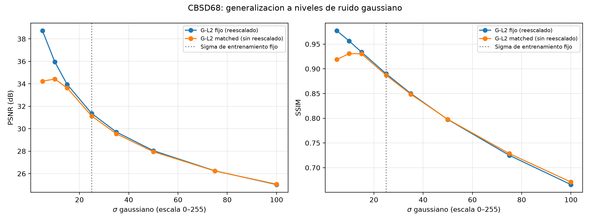 
  <em>PSNR y SSIM medios en CBSD68 frente a sigma: G-L2 fijo 10k con reescalado y G-L2 matched 10k sin reescalado.</em>

**Evaluación en CBSD68 a sigma 25.**

| Modelo | PSNR medio (dB) | SSIM medio |
|---|---:|---:|
| G-L2 fijo 10k | 31,35 | 0,8900 |
| G-L2 matched 10k | 31,13 | 0,8871 |

**Recorte de water castle a sigma 50.**

  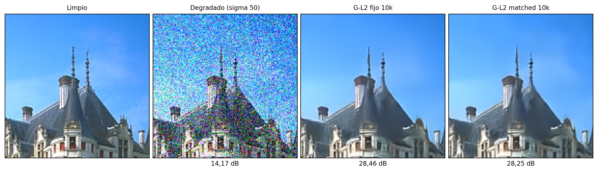 
  <em>Water castle: recorte a sigma 50. PSNR indicado sobre el recorte.</em>

- Se pierde a degradaciones bajas contra el especialista entrenado $\sigma = 25$-
- Leve mejora en bajas desviaciones. 

- No hay una ventaja al usar el entrenamiento variado en G-L2 que benefició a P-P

G-G VARIABLE (UNIFORM) 10K VS FIJO 10K

  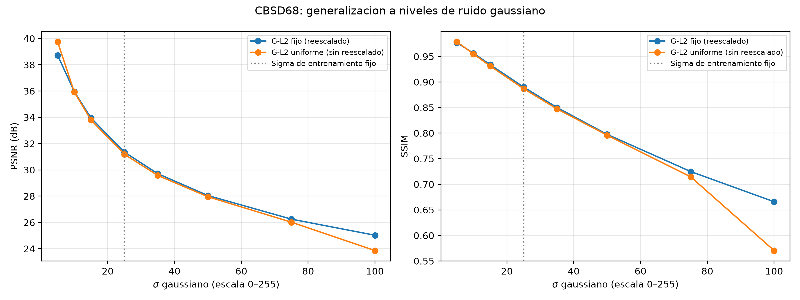 
  <em>PSNR y SSIM medios en CBSD68 frente a sigma: G-L2 fijo 10k con reescalado y G-L2 variable uniforme 10k sin reescalado.</em>

**Evaluación en CBSD68 a sigma 25.**

| Modelo | PSNR medio (dB) | SSIM medio |
|---|---:|---:|
| G-L2 fijo 10k | 31,35 | 0,8900 |
| G-L2 uniforme 10k | 31,19 | 0,8869 |

**Recorte de water castle a sigma 50.**

  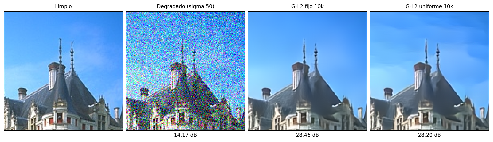 
  <em>Water castle: recorte a sigma 50. PSNR indicado sobre el recorte.</em>

- Generar variabildia a través de una Uniforme en vez de LogUniform, suple los problemas anteriores.
- De todos modos, sigue ganando globalmente especialista a $\sigma = 25$.

### 3.2 P-P: Generalización a otros peaks

P-P VARIABLE (MATCHED) 10K VS FIJO 10K

  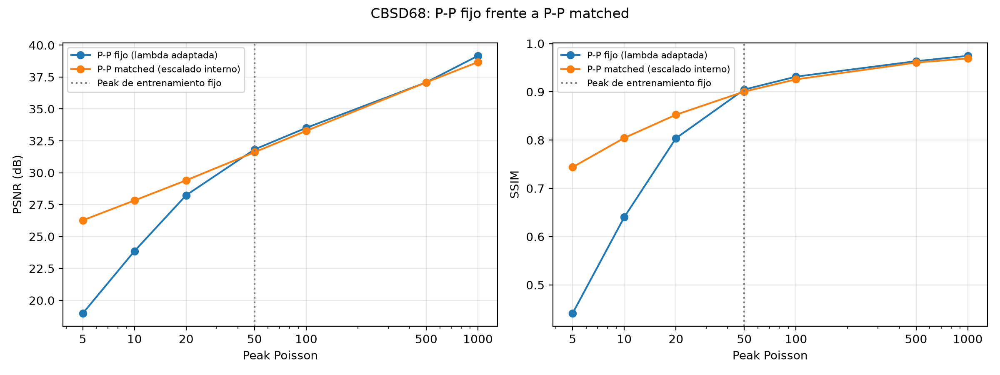 
  <em>PSNR y SSIM medios en CBSD68 frente al peak: P-P fijo 10k y P-P matched 10k.</em>

**Evaluación en CBSD68 a peak 50.**

| Modelo | PSNR medio (dB) | SSIM medio |
|---|---:|---:|
| P-P fijo 10k | 31,83 | 0,9047 |
| P-P matched 10k | 31,61 | 0,9006 |

**Recorte de water castle a peak 30.**

  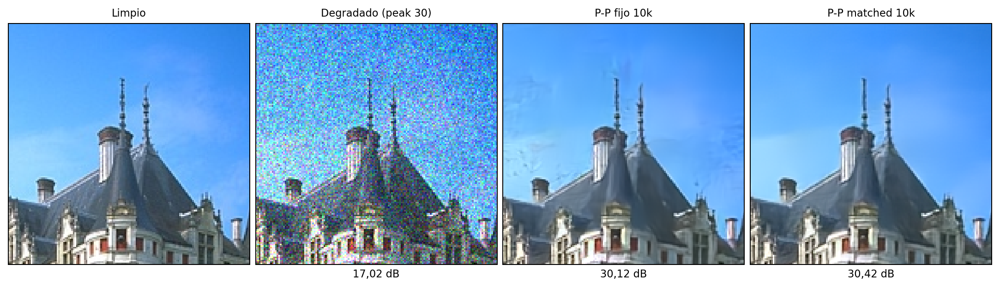 
  <em>Water castle: recorte a peak 30. PSNR indicado sobre el recorte.</em>

- Existe una mejora clara en degradaciones fuertes, problema del especialista.

- La diferencia contra el especialista en su paramétro entrenado (peak = 50), es pequeña pero existe.

## 4. Traslación a la transformada de Anscombe

### 4.1 Modelos Gaussianos comparados 
G-G VARIABLE (MATCHED) 10K VS FIJO 10K

  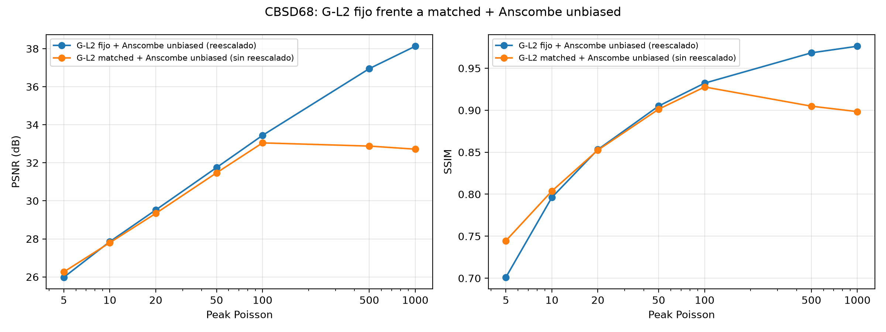 
  <em>PSNR y SSIM medios en CBSD68 frente al peak: G-L2 fijo 10k y G-L2 matched 10k, ambos con Anscombe e inversa unbiased.</em>

**Evaluación en CBSD68 a peak 50.**

| Modelo | PSNR medio (dB) | SSIM medio |
|---|---:|---:|
| G-L2 fijo 10k + Anscombe unbiased | 31,75 | 0,9050 |
| G-L2 matched 10k + Anscombe unbiased | 31,47 | 0,9013 |

**Recorte de water castle a peak 30.**

  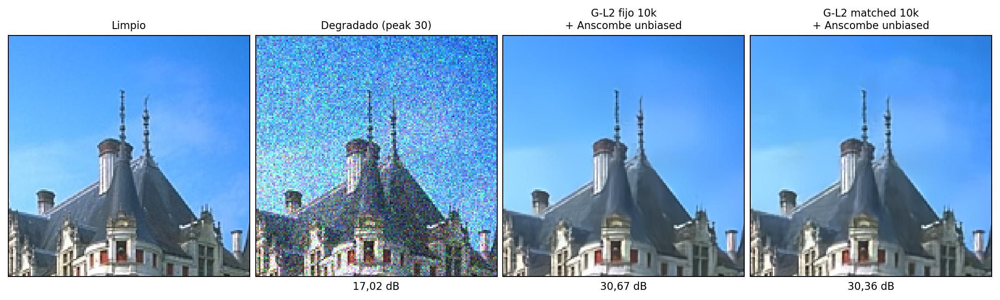 
  <em>Water castle: recorte a peak 30. PSNR indicado sobre el recorte.</em>

- Al pasar a la transformada el modelo gaussiano variable con LogU no presenta ventajas claras globales.
- Existe una leve mejora a peaks bajos.
- Sin embargo, dado los comportamientos irregulares en peaks altos, se sigue prefiriendo sigma especilista para usar Anscombe.

G-G VARIABLE (UNIFORM) 10K VS FIJO 10K

  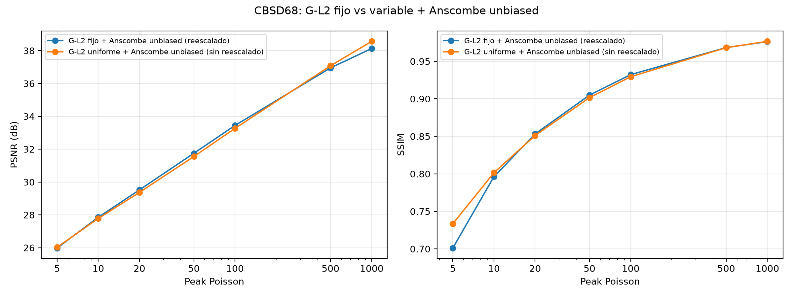 
  <em>PSNR y SSIM medios en CBSD68 frente al peak: G-L2 fijo 10k y G-L2 variable uniforme 10k, ambos con Anscombe e inversa unbiased.</em>

**Evaluación en CBSD68 a peak 50.**

| Modelo | PSNR medio (dB) | SSIM medio |
|---|---:|---:|
| G-L2 fijo 10k + Anscombe unbiased | 31,75 | 0,9050 |
| G-L2 uniforme 10k + Anscombe unbiased | 31,55 | 0,9016 |

**Recorte de water castle a peak 30.**

   
  <em>Water castle: recorte a peak 30. PSNR indicado sobre el recorte.</em>

- Sigma entrenado uniformemente suple los problemas anteriores.
- Presenta mejoras marginales en psnr, pero en SSIM existe una brecha a favor en peaks bajos.
- Se plantea como modelo final para usar Anscombe.

### 4.1 Modelos Gaussianos comparados a Poisson.

P-P VARIABLE (MATCHED) 10K VS G-L2 FIJO 

  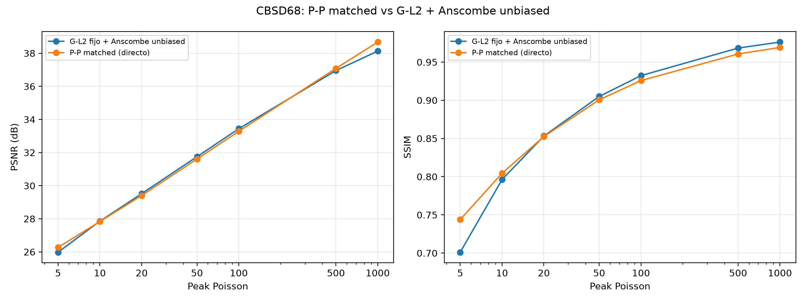 
  <em>PSNR y SSIM medios en CBSD68 frente al peak: P-P matched 10k directo y G-L2 fijo 10k con Anscombe e inversa unbiased.</em>

**Evaluación en CBSD68 a peak 50.**

| Modelo | PSNR medio (dB) | SSIM medio |
|---|---:|---:|
| G-L2 fijo 10k + Anscombe unbiased | 31,75 | 0,9050 |
| P-P matched 10k | 31,61 | 0,9006 |

**Recorte de water castle a peak 30.**

  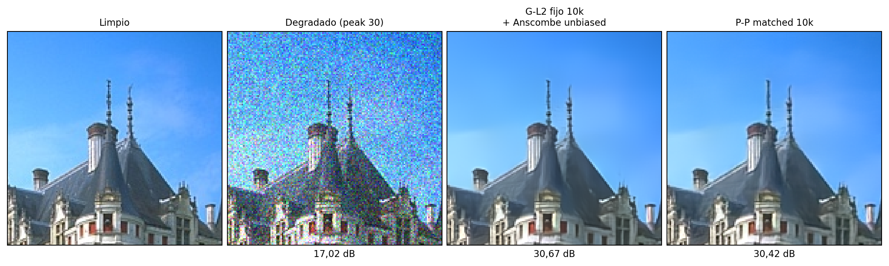 
  <em>Water castle: recorte a peak 30. PSNR indicado sobre el recorte.</em>

- P-P ahora compite contra la transformada, incluso presentando mejor rendimiento a bajos peaks.

- G-L2 fijo sigue ganando a peaks alto (efecto de la transformada), sin embargo P-P no "vió" ningun peak = 1000.

P-P VARIABLE (MATCHED) 10K VS G-L2 VARIABLE (UNIFORM)

  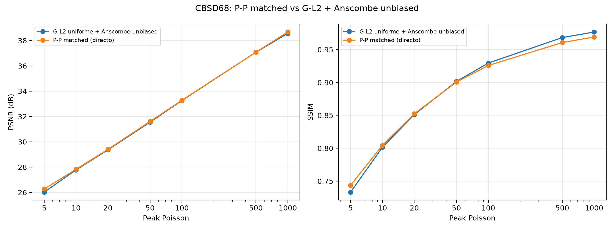 
  <em>PSNR y SSIM medios en CBSD68 frente al peak: P-P matched 10k directo y G-L2 variable uniforme 10k con Anscombe e inversa unbiased.</em>

**Evaluación en CBSD68 a peak 50.**

| Modelo | PSNR medio (dB) | SSIM medio |
|---|---:|---:|
| G-L2 uniforme 10k + Anscombe unbiased | 31,55 | 0,9016 |
| P-P matched 10k | 31,61 | 0,9006 |

**Recorte de water castle a peak 30.**

   
  <em>Water castle: recorte a peak 30. PSNR indicado sobre el recorte.</em>

- P-P variable presenta una relación similar con G-L2 variable en su mejor esquema (Uniforme).
- Por tanto, se concluye, que, a pesar de que ambos se ven beneficiados, la variabilidad genera una ventaja mayor en modelos de ruido Poisson.

## 5. Costo generalización en P-P (Trade-off)

1.Mismo presupuesto: fijo frente a matched a 10k, y luego a 20k.

   
  <em>PSNR y SSIM medios en CBSD68 frente al peak: P-P fijo 10k frente a P-P matched 10k.</em>

**Evaluación en CBSD68 a peak 50.**

| Modelo | PSNR medio (dB) | SSIM medio |
|---|---:|---:|
| P-P fijo 10k | 31,83 | 0,9047 |
| P-P matched 10k | 31,61 | 0,9006 |

  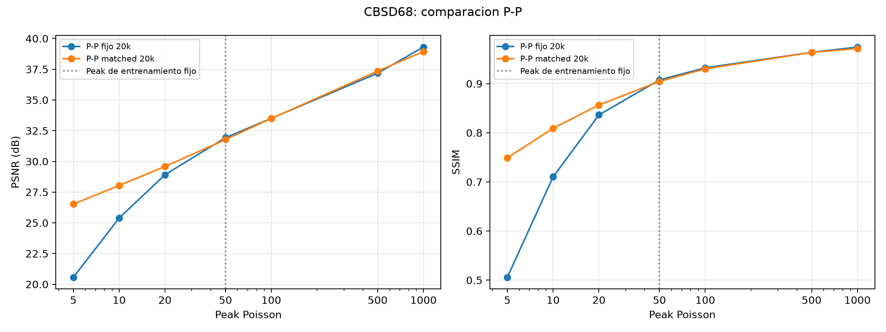 
  <em>PSNR y SSIM medios en CBSD68 frente al peak: P-P fijo 20k frente a P-P matched 20k.</em>

**Evaluación en CBSD68 a peak 50.**

| Modelo | PSNR medio (dB) | SSIM medio |
|---|---:|---:|
| P-P fijo 20k | 31,93 | 0,9075 |
| P-P matched 20k | 31,78 | 0,9045 |

**Recorte de water castle a peak 30.**

   
  <em>Water castle: recorte a peak 30. PSNR indicado sobre el recorte.</em>

- A mayor iteraciones P-P variable parece mejorar a mejor ritmo que P-P fijo.

- Se justifica aumentar más iteraciones a P-P variable.

- Se comienza a cerrar la brecha en la especialidad del fijo.

2.Más entrenamiento: 10k frente a 20k dentro de cada protocolo.

  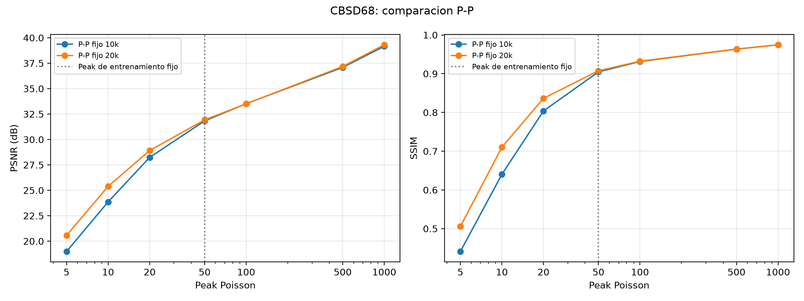 
  <em>PSNR y SSIM medios en CBSD68 frente al peak: P-P fijo 10k frente a P-P fijo 20k.</em>

**Evaluación en CBSD68 a peak 50.**

| Modelo | PSNR medio (dB) | SSIM medio |
|---|---:|---:|
| P-P fijo 10k | 31,83 | 0,9047 |
| P-P fijo 20k | 31,93 | 0,9075 |

**Recorte de water castle a peak 30.**

  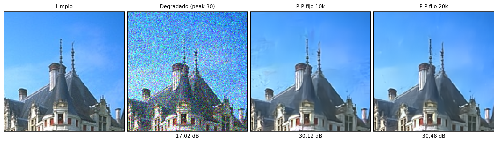 
  <em>Water castle: recorte a peak 30. PSNR indicado sobre el recorte.</em>

  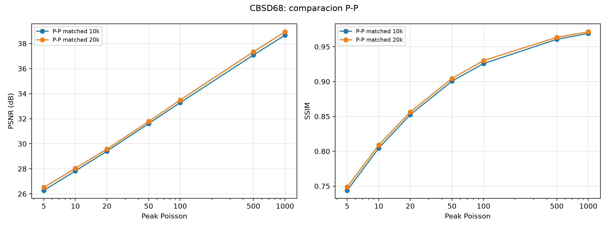 
  <em>PSNR y SSIM medios en CBSD68 frente al peak: P-P matched 10k frente a P-P matched 20k.</em>

**Evaluación en CBSD68 a peak 50.**

| Modelo | PSNR medio (dB) | SSIM medio |
|---|---:|---:|
| P-P matched 10k | 31,61 | 0,9006 |
| P-P matched 20k | 31,78 | 0,9045 |

**Recorte de water castle a peak 30.**

  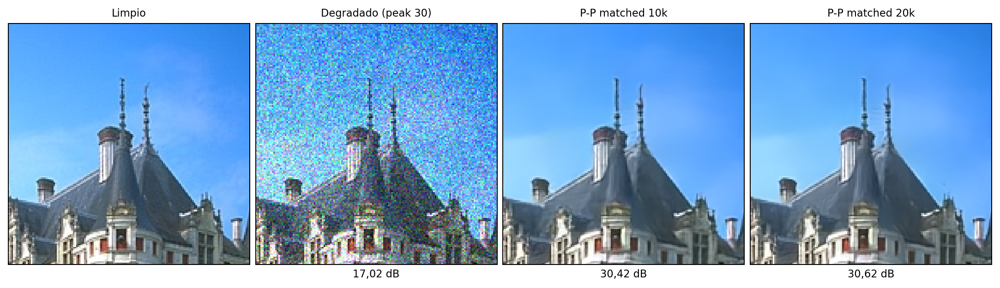 
  <em>Water castle: recorte a peak 30. PSNR indicado sobre el recorte.</em>

- Aca se invierte la relación anterior, mientras que P-P matched mejora en la especialidad más rapido que P-P fijo, P-P- fijo a mas iterciones mejora en la variabilidad.

- Sin embargo, dado que las métricas generales siguen bastante por debajo del modelo variado, se sigue teniendo la prioridad en mejorar las iteraciones de P-P variado.

3.Trade-Off: matched 20k frente a fijo 10k, especialmente a peak 50.

  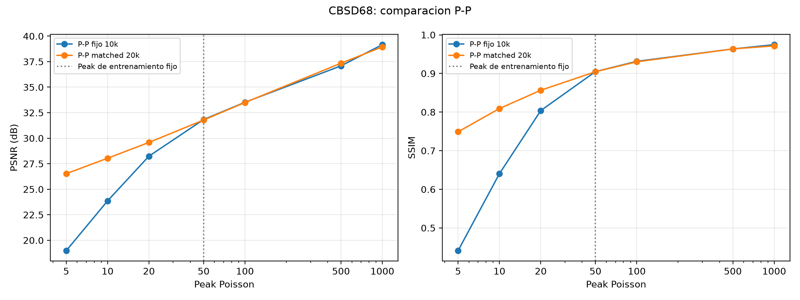 
  <em>PSNR y SSIM medios en CBSD68 frente al peak: P-P fijo 10k frente a P-P matched 20k.</em>

**Evaluación en CBSD68 a peak 50.**

| Modelo | PSNR medio (dB) | SSIM medio |
|---|---:|---:|
| P-P fijo 10k | 31,83 | 0,9047 |
| P-P matched 20k | 31,78 | 0,9045 |

**Recorte de water castle a peak 30.**

  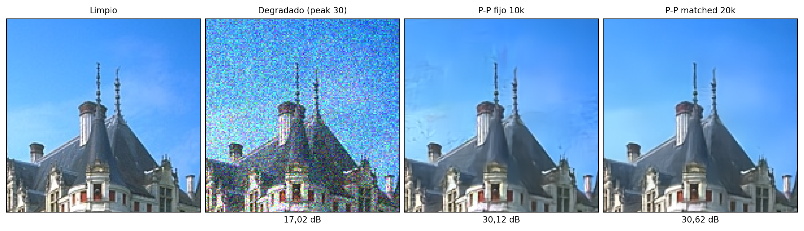 
  <em>Water castle: recorte a peak 30. PSNR indicado sobre el recorte.</em>

- Aproximadamente, toma unas 10k iteraciones adicionales al modelo variado alcanzar la especialidad del fijo. 

## 6. Checkpoint viejo: P-L2 al aumentar iteraciones.

- P-L2 era el modelo que presentaba menor desventajas al probar diferentes peaks.

- Nunca ganó a modelos con la trasnformada, pero sí a la supuesta parte especializa P-P.
- Se analiza si fue defecto de iteraciones.

  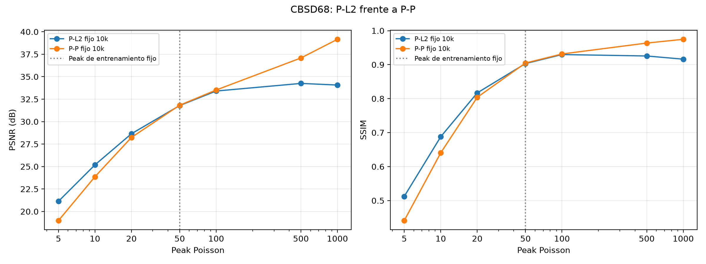 
  <em>PSNR y SSIM medios en CBSD68 frente al peak: P-L2 fijo 10k frente a P-P fijo 10k, ambos entrenados a peak 50.</em>

**Evaluación en CBSD68 a peak 50.**

| Modelo | PSNR medio (dB) | SSIM medio |
|---|---:|---:|
| P-L2 fijo 10k | 31,79 | 0,9032 |
| P-P fijo 10k | 31,83 | 0,9047 |

**Recorte de water castle a peak 30.**

  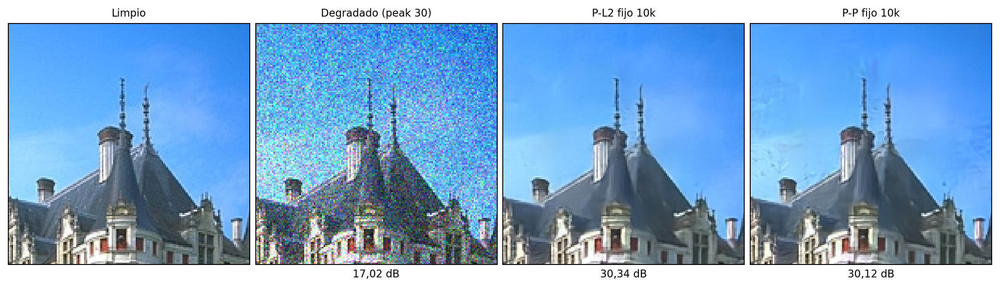 
  <em>Water castle: recorte a peak 30. PSNR indicado sobre el recorte.</em>

- Presenta la misma ventaja frente e P-P fijo, sin embargo, a 10K, P-P comienza a mejorar en peaks altos.

- Se descarta el modelo para futuro estudio.

## 7. Eventuales pasos

- Este fue un análisis cuantitativo, faltaría cualitativo, analizar los artefactos de poisson.

